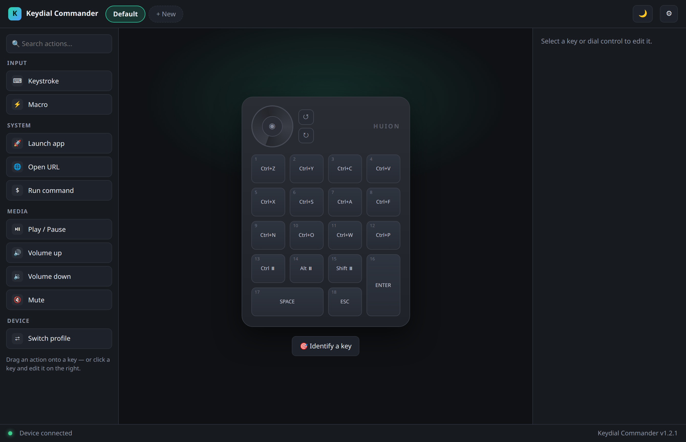
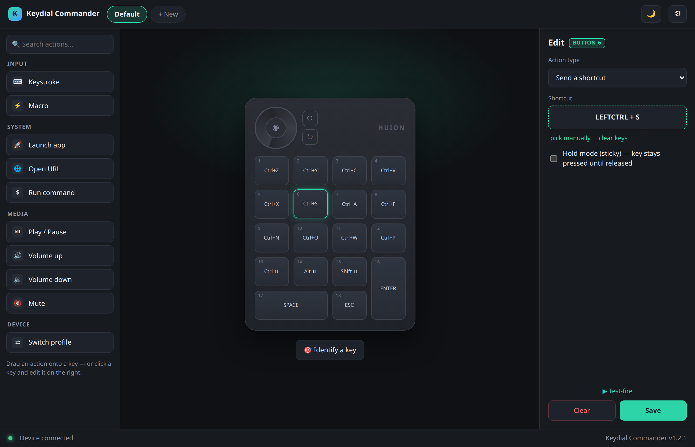
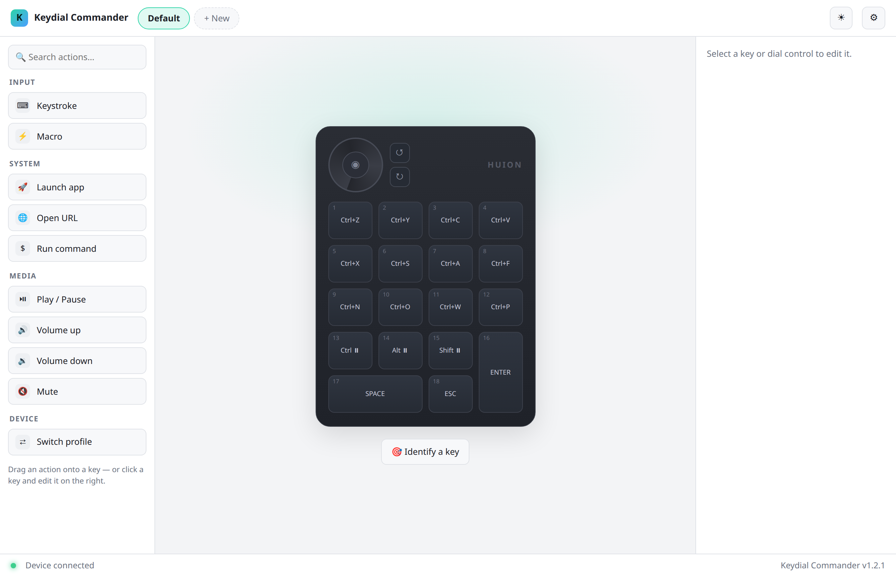

<div align="center">

# Keydial Commander

### Your Huion Keydial Mini. Your shortcuts. On Linux.

Turn the K20's 18 buttons and dial into a visual control surface for shortcuts,
macros, programs and profiles.

[**Download the preview**](https://github.com/the3dcoder/KeydialCommander/releases/tag/v1.3.0a1)
&nbsp; · &nbsp;
[Installation guide](docs/INSTALL.md)
&nbsp; · &nbsp;
[Roadmap](docs/ROADMAP.md)
&nbsp; · &nbsp;
[Report a problem](https://github.com/the3dcoder/KeydialCommander/issues)

[](https://github.com/the3dcoder/KeydialCommander/releases)
[](LICENSE)




</div>

## Make every control useful

- **Configure visually.** Select a button or dial action, choose an action, then
  **Save**. Click-to-edit and drag-and-drop both work.
- **Capture shortcuts naturally.** Record combinations such as `Ctrl+Shift+E`,
  including left/right modifiers and modifier-only holds.
- **Create macros.** Combine key sequences and delays without blocking input.
- **Launch programs and URLs.** Commands use explicit program arguments.
- **Keep separate profiles.** Create, clone, import and export YAML layouts;
  switch manually or bind a control to switch.
- **See what is happening.** Identify controls, watch live input feedback, and
  distinguish connection, readiness and output problems.
- **Recover predictably.** Disconnects and profile changes cancel old work and
  release owned keys. Recovery waits for released controls before fresh input.
- **Choose your workspace.** Dark, light and system themes; local browser UI or
  an optional GTK/WebKit desktop window.

<table>
<tr>
<td width="50%"></td>
<td width="50%"></td>
</tr>
<tr>
<td align="center">Select a control, configure an action, Save.</td>
<td align="center">A familiar layout in light or dark.</td>
</tr>
</table>

## Download and get started

Open [GitHub Releases](https://github.com/the3dcoder/KeydialCommander/releases)
and choose the **Linux preview bundle**. It includes the built web UI, Python
wheel, device-access rule, user-service template and optional desktop files.
**Node and a source checkout are not needed to run that download.**

| Download | Choose it for |
| --- | --- |
| [`keydial-commander-1.3.0a1-linux.tar.gz`](https://github.com/the3dcoder/KeydialCommander/releases/download/v1.3.0a1/keydial-commander-1.3.0a1-linux.tar.gz) | The complete preview bundle and installation instructions. Start here. |
| Python `.whl` | An existing Python installation with device access and service setup already managed. |
| `SHA256SUMS` | Checking that downloaded files match the published artifacts. |
| GitHub's automatic “Source code” archives | Development. These need a frontend build; use the Linux bundle to run the prebuilt UI. |

Follow the [installation guide](docs/INSTALL.md), then open
**http://127.0.0.1:8137**. Select a control, assign an action and press **Save**.
Profiles stay under `~/.config/huion-keydial-mini/profiles/`.

This is an **early preview**, not a qualified installation release. The next
delivery milestone is a tested Ubuntu package with a simpler installation.

## Device and platform status

| Area | Current evidence |
| --- | --- |
| Linux K20 remapping | Implemented with `evdev` capture and `uinput` output. Administrator access is needed for initial device-rule setup; the application runs as your user. |
| Bluetooth | Physical evidence from July 2026 on Ubuntu 24.04. The new recovery behavior still needs dated hardware qualification. |
| USB | Shares the Linux input path. Physical USB/data-cable qualification remains open. |
| Automated recovery checks | 192 Python tests passed with hardware capture excluded; 15 isolated browser regressions passed. See the [qualification record](docs/development/2026-10-30-k20-qualification.md). |
| Distribution packages | Ubuntu packaging is next. Existing Debian, Arch, Nix and RPM builders are unqualified. |

Normal buttons fire on release to recognize button chords. “Sticky” means
**hold while the physical control is pressed**, not a toggle. The dial emits
direction pulses. Saved dial sensitivity is not yet applied by the input path.
Battery reporting, a tray icon and automatic per-application profile switching
are still roadmap items.

## Build from source

For development, use Python and **Node 24 or newer**. Build the frontend before
installing a non-editable Python package so the installed wheel includes the UI:

```bash
git clone https://github.com/the3dcoder/KeydialCommander.git
cd KeydialCommander
python3 -m venv .venv
npm --prefix web ci
npm --prefix web run build
.venv/bin/python -m pip install .
```

See [CONTRIBUTING.md](CONTRIBUTING.md) for development, device permissions and
hardware-free checks. For the downloadable preview and its user service, use
the [installation guide](docs/INSTALL.md).

## Optional terminal controls

The CLI covers binding and profile management; the GUI exposes the full action
editor and YAML import/export.

```bash
keydialctl list-bindings
keydialctl list-keys
keydialctl bind BUTTON_1 KEY_LEFTCTRL+KEY_C
keydialctl bind --sticky BUTTON_13 KEY_LEFTCTRL
keydialctl bind DIAL_CW KEY_VOLUMEUP
keydialctl unbind BUTTON_1
keydialctl profile list
keydialctl profile create Krita --clone-from Default
keydialctl profile switch Krita
```

Controls are `BUTTON_1`–`BUTTON_18`, `DIAL_CW`, `DIAL_CCW` and `DIAL_CLICK`.
Use `BUTTON_1+BUTTON_2` for a button chord. The preview's CLI executables are in
`~/.local/share/keydial-commander/venv/bin/`; use that prefix if they are not on
your shell's `PATH`.

## Service and local API

```bash
systemctl --user status huion-keydial-mini-user.service
systemctl --user restart huion-keydial-mini-user.service
journalctl --user -u huion-keydial-mini-user.service -f
curl http://127.0.0.1:8137/api/status
```

The UI talks to a loopback HTTP/WebSocket API. Profiles persist as YAML;
commands run with your user privileges. Keep the API local. The
[architecture](ARCHITECTURE.md) explains capture, output ownership, recovery
and the control interfaces.

## What comes next

1. One tested Ubuntu installation artifact, including the UI and service.
2. Dated Bluetooth and USB qualification plus clearer local diagnostics.
3. Maintained device adapters, starting with a second available physical device.

[Full roadmap](docs/ROADMAP.md) · [Contribution guide](CONTRIBUTING.md) ·
[Device reference](docs/DEVICE-K20.md) · [Release process](docs/RELEASING.md)

[KeyCommand](https://keycommand.io) is the separate browser game. Commander
provides an optional [importable game profile](examples/keycommand-profile.yaml);
there is no live game-to-daemon bridge.

## License

[MIT](LICENSE). © 2026 Big Bwain LLC. Maintained by Earl.
